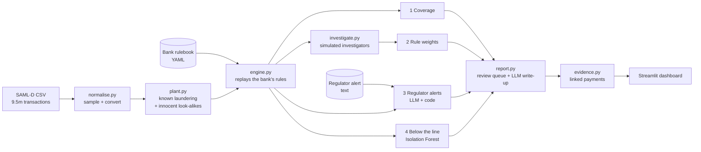

# Blindspot

An independent auditor for a bank's anti-money-laundering (AML) transaction monitoring.
Blindspot takes the bank's **rulebook** (its monitoring rules) and measures what those
rules **miss**. The industry measures false alarms because they cost money today; nobody
independently measures missed crime, because it stays invisible until a regulator finds it.

Built in 30 hours at a hackathon, prompted by the October 2026 Bank of America enforcement
action ($1.2bn, over $5bn of suspicious money missed or reported late). UK viewpoint
throughout: all amounts are GBP.

**Code computes every number, the AI reads regulation and writes the report, and a person
makes every decision.**

---

## Results (test bank, Northbridge rulebook)

| | Result |
|---|---|
| Planted laundering caught by the bank's rules | **18.4%** (23 of 125 customers) |
| Caught once Blindspot's review list is added | **81.6%** (79 of the 102 the bank missed) |
| Review list precision | **46.4%** are launderers, vs 0.89% at random (about 52x) |
| Bank's cases that were false alarms | 94% (realistic for rule-based monitoring) |
| Money moving through payment types no rule can see | £3,844,620 (money orders, 0% monitored) |
| Strongest under-weighted rule | Repeated near-limit cash: 1 point, right 26.9% of the time (3.9x average) |
| Advisory patterns (LLM-extracted) | Card funnels: 25 of 25 found, 0 innocent. Split money orders: 25 of 25, 0 innocent |
| Independent SAML-D laundering | 4 of 318 missed cases found (1.3%): see Known limits |

Figures are from the run on 17 October 2026 (50,500 customers). Rerun the pipeline to
reproduce them; later code fixes may move them slightly.

---

## How it works



There are two halves:

1. **A test bank with a known answer key.** Banks can't measure misses because they only
   know about the crime they already caught. We use a synthetic bank (SAML-D) and plant
   known laundering into it, so every catch and miss can be checked.
2. **Blindspot itself:** four independent checks that never see the answer key, plus a
   report that combines them.

### The test bank

| Step | What it does |
|---|---|
| **Normalise** (`normalise.py`) | Streams the 9.5m-row SAML-D CSV in 1m-row chunks. Samples **by customer** (whole histories, so schemes stay intact): 50,000 clean customers + 500 launderers, about 1 in 100, so the false-positive rate is realistic. Maps payment types to a fixed enum and treats amounts as GBP. |
| **Plant** (`plant.py`) | Adds five Bank of America-style patterns, 25 customers each, onto existing clean customers. Also adds innocent look-alikes (4% occasional money orders, 10% people repaying their own card, 3% shops banking takings, 2% normal overseas wires), so no payment type gives launderers away. |

| Planted pattern | What it looks like |
|---|---|
| `structured_money_orders` | 6–15 days, each with money orders totalling £2,400–£2,499, just under the £2,500 ID limit |
| `high_risk_wires` | 10–25 inbound wires of £15k–£60k from Belarus or Georgia within 60 days |
| `credit_card_funnel` | One shop repaying 15–40 unrelated people's credit cards, £300–£2,500 each |
| `structured_cash` | 6–15 cash deposits of £9,000–£9,900 within 1–3 months |
| `slow_burn` | A small deposit or high-risk payment every 25–45 days, too thin to score |

### The bank's rulebook and the engine

A rulebook is a YAML file: each rule's payment types, direction, trigger and points, plus
the case threshold, the scoring window and any "valued client" exemption. The format is
documented at the top of `blindspot/rulebook.py`; the validator rejects mistakes with
plain-English messages.

| Trigger type | Fires when |
|---|---|
| `single` | One payment meets the amount and country conditions |
| `repeated` | The Nth matching payment inside a rolling window |
| `velocity` | A count of payments in a fixed block of days |
| `aggregate` | A block's count, distinct counterparties and total all meet thresholds |

`engine.py` replays the rulebook: each firing adds points; a customer's score is the most
points inside any rolling window (13 months by default); a case opens at the threshold
unless the customer is exempt. **The engine reads transactions only, never the answers.**

| Rulebook | Purpose |
|---|---|
| `rulebooks/northbridge_bank.yaml` | Fictional bank with Bank of America's flaws: no money-order rule, a strong red flag worth 1 point, 5 exempt valued clients. The default. |
| `rulebooks/northbridge_bank_remediated.yaml` | The same bank after acting on Blindspot's findings. |
| `rulebooks/harbourside_building_society.yaml` | Untested. Stale rules; predicted flaws in `rulebooks/PREDICTIONS.md`. |
| `rulebooks/meridian_pay.yaml` | Untested. Watches only money going out; predicted flaws in `rulebooks/PREDICTIONS.md`. |

The predictions for the two untested rulebooks were written **before** running them, so
Blindspot can't be tuned to pass.

### The four checks

**1. Coverage** (`checks/coverage.py`, plain code). Groups all money by payment type and
direction, then reads each rule's scope. Each group is *unmonitored* (no rule can fire),
*count-only* (only a velocity rule, which never looks at amounts, countries or who is
paid) or *monitored*.

**2. Rule weights** (`checks/calibration.py`, statistics). For each rule, the share of
customers it flagged whom investigators then reported (its hit rate), with a **95% Wilson
score interval** so small samples can't produce confident claims. Suggested points =
threshold × hit rate, clamped to 1–threshold. A rule is called under- or over-weighted only
if the whole interval supports at least double (or half) its points *and* a gap of at
least 3 points, with at least 10 investigations. Investigation outcomes come from
`investigate.py`: every case, plus a random sample of 40 non-case customers per rule
("below-the-line testing", as regulators expect).

**3. Regulator alerts** (`checks/advisory.py`, LLM + code).
1. The LLM reads a regulator's alert (public text only) and returns each red flag as a
   pattern in a fixed JSON vocabulary: direction, payment types, customer type, amount
   range, window, minimum count, distinct counterparties, window total and repetitions.
   It must quote the red flag and state any threshold it had to assume.
2. Code validates every field and drops anything malformed.
3. Code searches the transactions (two offset sets of fixed windows, approximating a
   rolling window) and tests whether the bank's rules could see the matches and whether
   cases opened.
4. Red flags the vocabulary can't express (e.g. "repayments shortly *after* deposits")
   are listed for a human, not dropped.

**4. Below the line** (`checks/below_line.py`, machine learning). Builds 16 behaviour
measures per customer (volume, cash share, near-limit cash deposits, money orders,
deposits per day, high-risk share and count, money from abroad, distinct payees, cards
repaid, new-payee rate, peak 30-day activity, segment). Heavy-tailed measures are
log-scaled, then scored with an **Isolation Forest** (scikit-learn, 300 trees, seed 42),
an unsupervised anomaly detector that needs no labels. It ranks every customer who never
got a case, explains the top 50 as percentiles ("money in from abroad £831,312, top 0.1%
of customers"), and compares engine-score bands just under and just over the bank's
threshold.

### Report and evidence

**Review queue** (`report.py`). Customers with no case, scored by which checks flagged them:

| Signal | Priority points |
|---|---|
| Matches an advisory pattern | 3 |
| ML rank 1–25 / 26–100 | 3 / 2 |
| Exempted as a valued client despite reaching the threshold | 3 |
| Would reach a case if the under-weighted rules had their suggested points | 2 |

**LLM write-up with a number guard.** The LLM rewrites each finding for an auditor and
writes a board summary from aggregate facts only. Code extracts every number in its text
and **rejects the text if any number wasn't in the facts given** (rounding "£3,844,620" to
"£3.8m" is rejected too); code-written text is used instead. If the LLM is unavailable,
everything falls back to code-written text.

**Evidence** (`evidence.py`). Links each queued customer to the payments behind each
reason (advisory windows, suppressed alerts, under-weighted rule firings, the ML's top
features, unmonitored payment types), scores them (weights 3/3/2/2/1, plus up to 0.5 for
size) and keeps the top 25, flagging which payments the bank's rules never alerted on.

### Dashboard

`app.py` (Streamlit + Plotly). It opens empty; the user uploads or picks a rulebook,
adjusts it, and presses Run audit. The pipeline then runs with a live, narrated text log
and progress bar. Pages: Audit setup, Overview, Findings, Review queue (with per-customer
evidence timeline), the four checks, and Method & limits. Numbers count up and charts and
tables animate in with pure CSS (no JavaScript); reduced-motion settings are respected.

---

## Tools and technology

| Area | What we used |
|---|---|
| Language | Python 3.13 / 3.14 |
| Data | pandas 3, NumPy 2, PyArrow (Parquet files between steps) |
| Machine learning | scikit-learn **Isolation Forest** (unsupervised anomaly detection) |
| Statistics | Wilson score interval for rule hit rates (hand-written) |
| Language model | **`openai/gpt-oss-120b`** (OpenAI's open-weight model) via the **Groq** API free tier; OpenRouter supported as a fallback. Called through the `openai` Python SDK (OpenAI-compatible endpoint), temperature 0, JSON mode |
| LLM safety | Disk cache (`llm_cache/`, committed) so demos run offline with identical output; number guard; only public text and totals sent |
| Rulebooks | YAML (PyYAML), validated in `blindspot/rulebook.py` |
| Dashboard | Streamlit (≥1.50, top navigation), Plotly charts, custom CSS |
| Secrets | `python-dotenv`; `.env` is git-ignored |
| Dataset | [SAML-D](https://www.kaggle.com/datasets/berkanoztas/synthetic-transaction-monitoring-dataset-aml), Oztas et al., Bournemouth University (2023): 9.5m synthetic transactions, 28 typologies |
| AI-assisted development | Code written with **Claude** (Anthropic, Claude Opus 5.5), working with the team, which made the design decisions, ran everything on real data and reviewed the results |
| Testing | Streamlit `AppTest` for every page; a headless browser to check the animations and live log; `pyflakes` static checks |

---

## Run it

### Setup (macOS)

```bash
python3 -m venv .venv
source .venv/bin/activate          # in every new terminal window
pip install -r requirements.txt
```

For the LLM steps, create a `.env` file (git ignores it):

```
GROQ_API_KEY=your-key-here
# optional: LLM_PROVIDER=openrouter, OPENROUTER_API_KEY=..., LLM_MODEL=..., LLM_OFFLINE=1
```

### Quick test without SAML-D (a 2,000-customer fake bank)

```bash
python -m blindspot.make_sample
python -m blindspot.run_all --data data/sample
```

### Real data

```bash
python -m blindspot.normalise path/to/SAML-D.csv --customers 50000 --laundering 500   # -> data/base/
python -m blindspot.run_all                                                         # every other step
streamlit run app.py                                                                # dashboard
```

Audit a different rulebook from the command line:

```bash
python -m blindspot.run_all --from engine --rules rulebooks/northbridge_bank_remediated.yaml
```

### Pipeline

| Step | Module | Reads | Writes |
|---|---|---|---|
| Normalise | `normalise.py` | SAML-D CSV | `data/base/` transactions, labels |
| Plant | `plant.py` | `data/base/` | `data/` transactions, labels, planted_customers |
| Engine | `engine.py` | transactions **only** + the rulebook | alerts, cases, rules, rulebook_used.yaml |
| Evaluate | `evaluate.py` | answers | prints what the bank's rules caught |
| Investigate | `investigate.py` | answers, for reviewed customers only | investigations |
| 1 Coverage | `checks/coverage.py` | transactions, rules, alerts | coverage, findings |
| 2 Rule weights | `checks/calibration.py` | alerts, rules, investigations | calibration, findings |
| 3 Regulator alerts | `checks/advisory.py` | an advisory (LLM), transactions, rules, cases | advisory, findings |
| 4 Below the line | `checks/below_line.py` | transactions, cases (ML) | below_line, findings |
| Report | `report.py` | all findings (LLM writes text) | findings, review_queue, summary.json |
| Evidence | `evidence.py` | review queue, transactions, alerts | evidence |
| Dashboard | `app.py` | the files above | the screen |

`run_all` runs Plant → Evidence in order, stops at the first failure, and takes
`--from <step>`, `--data <folder>` and `--rules <file>`. All table shapes live in
`blindspot/schema.py`.

---

## Rules the code follows

- **The engine and the four checks never read the answers** (`labels.parquet`,
  `planted_customers.parquet`). Only `evaluate`, `investigate` and sections marked PROOF
  do. Test it: move `data/labels.parquet` away and run the checks with `--no-proof`; the
  report then simply skips validation, as it would at a real bank.
- **Monitor by `customer_id`, not `sender_id`.** Inbound payments belong to the receiver.
- **"Caught" is customer-level:** a launderer is caught if the bank opened a case.
- **Only public text and totals go to the LLM**, never transactions or customer IDs.
- **Seed 42 everywhere**, so every run gives the same results.

## Known limits (say these before a judge does)

- **The planted results measure patterns we designed.** On SAML-D's own, independent
  laundering, Blindspot adds little (1.3%): it's mostly networks of accounts, and every
  check looks at one customer at a time. A network check is the next module.
- **Slow burn is rarely found.** It's designed to look normal.
- **A missing rule on an otherwise-watched payment type** (e.g. no structuring rule for
  cash) is hard for any check to see; see `rulebooks/PREDICTIONS.md`.
- **Investigators are simulated as always right.**
- **Synthetic data only contains patterns someone imagined.** Regulators don't accept it
  as proof of real-bank performance; the next step is a pilot on anonymised real data.
- **The £2,500 and £10,000 limits are the fictional bank's own policies**, not UK law.
- **The advisory in `advisories/` is illustrative**, written by the team in the style of a
  UK alert. In production Blindspot reads the real text.

## Next steps

- A network check (fan-in, cycles, layering across accounts) for SAML-D-style laundering.
- Compare the bank's high-risk country list with a maintained reference list.
- A fully local LLM option (e.g. Ollama) so nothing leaves the bank's network.
- A second independent dataset (IBM AMLworld) via its own `normalise_ibm.py`.